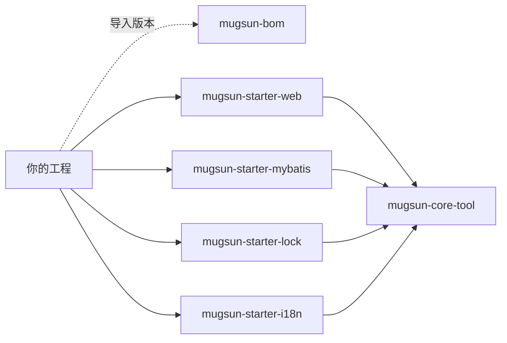

# mugsun-core

[English](./README_EN.md) | [文档](https://docs.mugsun.com/core/) | [更新日志](./CHANGELOG.md)

[](https://github.com/mugsun/mugsun-core/actions/workflows/ci.yml)
[](https://central.sonatype.com/search?q=com.mugsun)
[](./LICENSE)

mugsun 后端的公共库，由一个 BOM、一个工具包和四个 Spring Boot Starter 组成。

引入后，接口就有了统一的响应格式、全局异常处理和 Sa-Token 注解鉴权。它是依赖库，不能单独运行，可以运行的后端是 [mugsun-boot](https://github.com/mugsun/mugsun-boot)。

## 安装

最新版本是 `0.3.0`（基于 Spring Boot 4），已经发布到 Maven Central，直接引用就行，不用先装到本地。需要 JDK 21 和 Maven 3.9+。

在自己的工程里导入 BOM，再声明要用的 Starter：

```xml
<dependencyManagement>
  <dependencies>
    <dependency>
      <groupId>com.mugsun</groupId>
      <artifactId>mugsun-bom</artifactId>
      <version>0.3.0</version>
      <type>pom</type>
      <scope>import</scope>
    </dependency>
  </dependencies>
</dependencyManagement>

<dependencies>
  <dependency>
    <groupId>com.mugsun</groupId>
    <artifactId>mugsun-starter-web</artifactId>
  </dependency>
  <dependency>
    <groupId>com.mugsun</groupId>
    <artifactId>mugsun-starter-mybatis</artifactId>
  </dependency>
</dependencies>
```

还在用 Spring Boot 3 的工程用 `0.2.0`（分支 `release/0.2.0`）。

Maven Central 上的 `0.1.0` 是最早的版本，不要再用：它的接口加密和后面的版本不兼容，发布时的许可是 Apache-2.0。从 `0.1.0` 升上来见[升级说明](https://docs.mugsun.com/guide/upgrade/core-0-2-0)，各版本改了什么见[更新日志](./CHANGELOG.md)。

要用主干上还没发布的代码，先装到本地仓库，再把上面的版本号换成根 `pom.xml` 里的版本：

```bash
git clone https://github.com/mugsun/mugsun-core.git && cd mugsun-core
mvn -B clean install -DskipTests
```

## 写一个接口

```java
@RestController
@RequestMapping("/book")
public class BookController {

    private final BookService bookService;

    public BookController(BookService bookService) {
        this.bookService = bookService;
    }

    @SaCheckPermission("book:view")
    @GetMapping("/{id}")
    public R<BookVO> detail(@PathVariable Long id) {
        BookVO book = bookService.detail(id);
        if (book == null) {
            throw new ServiceException("图书不存在");
        }
        return R.data(book);
    }
}
```

查到数据时，响应是这样的：

```json
{
  "code": 200,
  "success": true,
  "data": { "id": "277980892367867904", "title": "三体" },
  "msg": "操作成功",
  "dataType": null
}
```

`id` 是字符串。超出 ±2^53 的 `Long` 和 `BigInteger` 会序列化成字符串，长整型主键到了浏览器里不会丢精度。

其他情况不用自己处理，Starter 会转成同一种格式：

| 情况 | HTTP 状态码 | `code` |
| --- | --- | --- |
| 抛出 `ServiceException` | 200 | 400，也可以传入别的 `ResultCode` |
| 参数校验失败 | 400 | 400 |
| 未登录 | 401 | 401 |
| 没有权限或角色，或抛出 `ForbiddenException` | 403 | 403 |
| 地址不存在 | 404 | 404 |
| 请求方法不对 | 405 | 400 |
| 唯一约束冲突（需要 `mugsun-starter-mybatis`） | 400 | 400 |
| 其他没有捕获的异常 | 500 | 500 |

没有捕获的异常还会交给 `ErrorLogListener`。实现这个接口并注册成 Bean，就能把错误写进自己的日志表。

## 有哪些模块



| 模块 | 内容 |
| --- | --- |
| `mugsun-bom` | 锁定本仓库构件和第三方依赖的版本，比如 MyBatis-Flex、Sa-Token 和 JetCache |
| `mugsun-core-tool` | 统一响应 `R`、业务异常和树形工具，不依赖 Spring |
| `mugsun-starter-web` | 全局异常处理、注解鉴权和接口加解密，另有大整数序列化和 Excel 工具 |
| `mugsun-starter-mybatis` | MyBatis-Flex 和实体基类 `BaseEntity`，以及唯一约束冲突的处理 |
| `mugsun-starter-lock` | 分布式锁，有注解和模板两种用法；有 Redis 用 Redis，没有就退回单机锁 |
| `mugsun-starter-i18n` | 多语言：提示语跟着请求的语言走；代码里写好的中文提示不用改，放一份翻译文件就行 |

Starter 注册的 Bean 都可以覆盖。自己声明一个同类型的 Bean，Starter 的那个就不再生效。

### 实体基类

```java
@Table("book")
public class Book extends BaseEntity {
    private String title;
}
```

继承 `BaseEntity` 后，实体就有了自动生成的长整型主键 `id`。创建时间、更新时间和逻辑删除标记也由它维护。

保存前调用 `sanitizeForInsert()`，可以清掉请求体里带进来的时间和删除标记。

### 树和 Excel

```java
// 节点类实现 INode<T>，第二个参数是根节点的 parentId
List<Menu> tree = TreeUtil.build(menus, 0L);

// 列和字段的对应关系用 @ExcelProperty 声明
List<BookRow> rows = ExcelUtil.read(file, BookRow.class);
ExcelUtil.export(response, "图书", "Sheet1", rows, BookRow.class);
```

## 接口加解密

在接口上加 `@ApiDecrypt` 会解密请求体，加 `@ApiEncrypt` 会加密响应里的 `data`。算法是 SM4-GCM。

```java
@ApiDecrypt
@ApiEncrypt
@PostMapping("/login")
public R<LoginVO> login(@RequestBody LoginDTO dto) {
    return R.data(authService.login(dto));
}
```

请求体要写成 `{"encryptData": "<密文>"}`。响应里的 `data` 是密文，`dataType` 的值是 `ENCRYPT`。

> [!WARNING]
> 这只是传输混淆，不能代替 HTTPS。密钥要下发给浏览器，对客户端不保密，密文也不防重放。

密钥不配也能启动。第一次启动会生成一个 16 字节的密钥，存在 `~/.mugsun/api-transport.key`，之后重启继续用它。

下面两种部署必须自己配密钥，或者给密钥目录挂共享卷：

- 用 Docker 运行，但没有给这个目录挂卷。每次重启都会换一个新密钥。
- 部署了多个实例。每个实例各生成一个密钥，互相解不开。

| 配置项 | 默认值 | 说明 |
| --- | --- | --- |
| `mugsun.crypto.api-key` | 空 | 32 位 hex，或解码后正好 16 字节的 base64。格式不对会拒绝启动 |
| `mugsun.home` | `~/.mugsun` | 自动生成的密钥文件放在这个目录 |

密钥可以用 `openssl rand -hex 16` 生成。

在 mugsun-boot 里，这两项对应环境变量 `MUGSUN_API_KEY` 和 `MUGSUN_HOME`。

密文的格式是 `base64(12 字节 IV + 密文 + 16 字节标签)`。

写其他语言的客户端时，可以用 [api-crypto-vectors.json](./mugsun-starter-web/src/test/resources/crypto/api-crypto-vectors.json) 里的数据核对。

更多说明见[配置参考](https://docs.mugsun.com/boot/configuration)。

## 分布式锁

引入 `mugsun-starter-lock` 后，同一件事在多个实例里同一时刻只有一个在做。不用写配置：工程里有 Redis 就把锁放在 Redis 里，没有就退回单机锁，启动时提醒一句。

```xml
<dependency>
  <groupId>com.mugsun</groupId>
  <artifactId>mugsun-starter-lock</artifactId>
</dependency>
```

在方法上加注解：

```java
// 同一个订单同时只能有一个在支付；别的请求最多等 3 秒，等不到就返回「操作正在进行中，请稍后再试」
@DistributedLock(key = "#orderId", waitTime = 3)
public void pay(Long orderId) {
    // ...
}

// 定时任务：多个实例里只让一个执行，别的实例这一次直接跳过
@Scheduled(cron = "0 0 3 * * *")
@DistributedLock(name = "job:log-clean", onFail = LockFailAction.SKIP)
public void clean() {
    // ...
}
```

也可以注入 `LockTemplate` 自己调：

```java
// 最多等 3 秒，等不到抛 LockFailedException
lockTemplate.run("order:pay:" + orderId, Duration.ofSeconds(3), () -> pay(orderId));

// 抢不到就跳过，返回值说明这一次有没有执行
boolean ran = lockTemplate.tryRun("job:log-clean", this::clean);
```

几条约定：

- 不写租期时，锁一直占到方法结束，执行期间自动续期。进程崩溃后没人续期，锁在 30 秒内自己放开。
- 写了 `leaseTime` 就是固定租期，到时间一定放开，不管方法有没有执行完。
- 锁包在事务外面：先拿锁再开事务，事务提交以后才放锁。
- 同一个线程可以重复拿同一把锁，不会自己挡住自己。
- 没抢到锁时抛 `LockFailedException`。它是 `ServiceException`，接口返回的是一次普通的业务失败。
- 注解靠 Spring 代理生效，同一个类里自己调自己不会加锁，这种场合用 `LockTemplate`。

| 配置项 | 默认值 | 说明 |
| --- | --- | --- |
| `mugsun.lock.type` | `auto` | `auto`：有 Redis 用 Redis，没有就用单机锁。`redis`：必须用 Redis，工程里没配 Redis 就拒绝启动。`local`：只用单机锁 |
| `mugsun.lock.key-prefix` | `lock:` | 锁在 Redis 里的统一前缀 |
| `mugsun.lock.lease-time` | `30s` | 不写租期时的租期，持有期间自动续 |
| `mugsun.lock.retry-interval` | `100ms` | 等锁时隔多久再抢一次 |
| `mugsun.lock.enabled` | `true` | 设成 `false` 整个关掉 |

> [!WARNING]
> 单机锁只在一个实例内互斥。部署多个实例时要引入 `spring-boot-starter-data-redis`。生产环境建议配 `mugsun.lock.type=redis`，这样工程里没配 Redis 时会启动失败，不会悄悄退回单机锁。

锁挡的是正常情况下的同时执行。Redis 数据丢失、进程长时间停顿时，仍然可能有第二个进来。不能接受的地方，数据库里要有唯一约束或版本号兜底。

## 多语言

引入 `mugsun-starter-i18n` 后，接口返回的提示语跟着请求头 `Accept-Language` 走。不用写配置，代码里已经写好的中文提示也不用改，放一份翻译文件就行。

```xml
<dependency>
  <groupId>com.mugsun</groupId>
  <artifactId>mugsun-starter-i18n</artifactId>
</dependency>
```

新建 `src/main/resources/i18n/messages_en.properties`。等号左边写代码里的中文原文，右边写译文：

```properties
用户不存在=User not found
用户 {0} 不存在=User {0} does not exist
名称不能为空=Name is required
```

代码照常写：

```java
// 整句固定的提示语不用改。英文请求返回 User not found，中文请求返回原文
throw new ServiceException("用户不存在");

// 带变量的句子用 I18n.get，变量的位置写 {0}、{1}
throw new ServiceException(I18n.get("用户 {0} 不存在", username));

// 校验注解里的提示语也一样
@NotBlank(message = "名称不能为空")
private String name;
```

框架自己的提示语（操作成功、没有访问权限、资源不存在等）自带英文翻译，不用再写。

几条约定：

- 翻译文件放在 `i18n/` 目录下，文件名是 `名字_语言.properties`，比如 `messages_en`、`messages_zh_TW`、`messages_ja`。文件用 UTF-8，中文直接写。
- 一行里第一个等号左边整个是键，空格和冒号直接写。键里有等号时写成 `\=`。
- 不带语言的 `messages.properties` 是兜底文案，某种语言里找不到这一句时用它。
- 请求没带 `Accept-Language`，或者带的语言都不支持，用默认语言（简体中文）。支持哪些语言不用登记：默认语言、简体中文，再加上有翻译文件的语言。
- 找不到翻译不报错，原样返回。
- 同一句话在几个文件里都有时，应用自己的 `messages` 优先。想换掉框架自带的译文，在自己的 `messages_en.properties` 里写同一个键。
- 只翻译统一响应 `R` 里的 `msg`，不动 `data`。
- 不想拿中文原文做键，可以用码：`ServiceException("{order.closed}")`、`@NotBlank(message = "{user.name.required}")`、`I18n.get("order.created", orderNo)`。这时中文写在 `i18n/messages.properties` 里。
- 带 `{0}` 的句子（原文和译文都是）按 `MessageFormat` 的写法：单引号要写两个（`It''s {0}`），要原样显示的花括号用单引号括起来（`'{'`）。
- 填进 `{0}` 的值和用加号拼字符串时一样显示：数字不加千分位，编号、行号、条数直接传就行。想按语言的习惯显示，占位写成 `{0,number}`。
- 语言跟着处理请求的线程走。`@Async`、线程池和定时任务里取到的是默认语言，需要别的语言时用 `I18n.get(locale, ...)`。
- 过滤器里自己写响应的地方（限流、登录校验这类）不经过统一响应 `R`，要自己翻译：`I18n.translate("请求过于频繁")`。过滤器里取到的语言和控制器里一样。
- 按 Spring Boot 的习惯放在类路径根目录的 `messages*.properties` 也照样读。

文案放在数据库里时，实现 `MessageProvider` 并注册成 Bean。查文案时先问它，它返回 `null` 再查翻译文件：

```java
@Component
public class DbMessageProvider implements MessageProvider {

    @Override
    public String find(String code, Locale locale) {
        // 每次查文案都会调到这里，要走缓存，不要每次查库
        return cache.get(locale, code);
    }
}
```

`MessageProvider` 出错不会让请求失败：这一次改用翻译文件里的文案，日志里记一条 WARN，一分钟最多一条。

| 配置项 | 默认值 | 说明 |
| --- | --- | --- |
| `mugsun.i18n.default-locale` | `zh-CN` | 请求没说要什么语言、或者要的语言不支持时用它。定时任务这类不在请求里的代码也用它 |
| `mugsun.i18n.supported-locales` | 空 | 不写时自动定：默认语言、简体中文，再加上有翻译文件的语言。写了就只认默认语言和写的这几种 |
| `mugsun.i18n.translate-response` | `true` | 返回前翻译 `R` 里的提示语。设成 `false` 后，只有用 `I18n.get` 取的文案跟着语言走 |
| `mugsun.i18n.enabled` | `true` | 设成 `false` 整个关掉 |

> [!NOTE]
> 前端要在请求头里带 `Accept-Language`。mugsun-pc 已经带了，切换界面语言后会跟着变。

简体中文总是支持的，因为代码里的提示语本来就是简体中文。只想返回英文一种语言时，把 `mugsun.i18n.default-locale` 和 `mugsun.i18n.supported-locales` 都写成 `en`。

想按别的办法定语言（比如按登录用户的设置），自己注册一个名为 `localeResolver` 的 Bean，Starter 的那个就不再生效。

网关这类不是 Spring MVC 的应用（比如 Spring Cloud Gateway）也可以引入。翻译文件照样读，只是不会自动定语言，也不会自动翻译响应。先按请求头把语言定下来，再翻译：

```java
Locale locale = I18n.negotiate(request.getHeaders().getFirst("Accept-Language"));
String msg = I18n.translate(locale, "请求未授权");
```

## 目前的限制

- 需要 Spring Boot 4 和 JDK 21。还在用 Spring Boot 3 的工程用 `0.2.x`（分支 `release/0.2.0`）。
- JSON 暂时还用 Jackson 2：Spring Boot 4 默认是 Jackson 3，`mugsun-starter-web` 把接口读写 JSON 的默认库设回了 Jackson 2，自定义序列化器仍按 `com.fasterxml.jackson` 写。应用把 `spring.http.converters.preferred-json-mapper` 设成 `jackson` 会换回 Jackson 3，但 Long 转字符串等按 Jackson 2 写的功能不会跟着生效。
- 只支持 Spring MVC，不支持 WebFlux。
- 分布式锁等锁时靠定时重试，不保证先来先得。
- 多语言按整句对翻译。用加号拼出来的句子对不上，要改成 `I18n.get` 的写法才会翻译。

## 相关仓库

| 仓库 | 说明 |
| --- | --- |
| [mugsun-boot](https://github.com/mugsun/mugsun-boot) | 后端，本仓库最主要的使用者 |
| [mugsun-pc](https://github.com/mugsun/mugsun-pc) | 管理后台 |
| [mugsun-docs](https://github.com/mugsun/mugsun-docs) | 文档站 [docs.mugsun.com](https://docs.mugsun.com/) 的源码 |

## 参与贡献

提交前请读[贡献指南](./CONTRIBUTING.md)。安全问题请按 [SECURITY.md](https://github.com/mugsun/.github/blob/main/SECURITY.md) 私下报告，不要开公开 Issue。

<details>
<summary>发布到 Maven Central</summary>

在本仓库发布一个 GitHub Release，或者手动运行工作流 `Publish to Maven Central`。

本地的等价命令如下，需要先配好 Central Portal 令牌和 GPG：

```bash
mvn -Prelease clean deploy -DskipTests
```

</details>

## 许可

MIT，见 [LICENSE](./LICENSE)。Maven Central 上的 `0.1.0` 在发布时声明的是 Apache-2.0。
