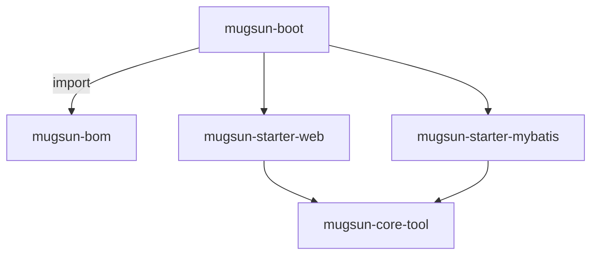

<p align="center">
  
</p>

# mugsun-core

**中文** | [English](./README_EN.md)

**boot 同栈的公共内核：一份 BOM，两个 Starter，业务工程直接 import。**  
统一响应、Sa-Token 注解鉴权、接口国密、MyBatis-Flex 实体基类——不是可独立跑的业务后端。

[文档](https://docs.mugsun.com/core/) · [架构](https://docs.mugsun.com/guide/architecture) · [演示（即将上线）](https://docs.mugsun.com/demo)


---

## 为什么选它

1. **和 boot 同版本锁**：父工程 Spring Boot **3.5.13**、Java **21**；`mugsun-bom` 把 Flex / Sa-Token / JetCache 等钉死，避免每个服务各写一份。
2. **显式自动装配**：`AutoConfiguration.imports` 挂上全局异常、鉴权拦截、加解密与实体基类；`@ConditionalOnMissingBean` 可覆盖。
3. **坐标已定，发布进行中**：`groupId`=`com.mugsun`，版本 **0.1.0**。Maven Central 发布流程已接入（`-Prelease`）；**首次成功同步前**仍用下方本地 `mvn install` 作为回退，供 [mugsun-boot](https://github.com/mugsun/mugsun-boot) 等业务仓引用。

它没有 HTTP 入口，也不能 `spring-boot:run`——要可运行后端请去 boot。

---

## 最短路径

发布到 Maven Central 并完成同步后，业务工程可直接按下述坐标引入，无需平级 install。

**在此之前**（当前状态），与 boot **平级** clone 后本地安装一次作为回退：

```bash
git clone https://github.com/mugsun/mugsun-core.git
cd mugsun-core
mvn clean install -DskipTests
```

业务工程 import BOM（版本与本仓一致，当前 **0.1.0**），再按需引入 Starter：

```xml
<dependencyManagement>
  <dependencies>
    <dependency>
      <groupId>com.mugsun</groupId>
      <artifactId>mugsun-bom</artifactId>
      <version>0.1.0</version>
      <type>pom</type>
      <scope>import</scope>
    </dependency>
  </dependencies>
</dependencyManagement>

<dependencies>
  <dependency>
    <groupId>com.mugsun</groupId>
    <artifactId>mugsun-starter-web</artifactId>
  </dependency>
  <dependency>
    <groupId>com.mugsun</groupId>
    <artifactId>mugsun-starter-mybatis</artifactId>
  </dependency>
</dependencies>
```

联调整条竖切：[boot 最短路径](https://github.com/mugsun/mugsun-boot#最短路径本地) · [文档 · 快速开始](https://docs.mugsun.com/guide/getting-started)。

---

## 它长什么样



```text
mugsun-core/
  mugsun-bom/            # 版本锁定（含 mybatis-spring → 3.0.5 覆盖）
  mugsun-core-tool/      # R / ResultCode / 业务异常 / TreeUtil
  mugsun-starter-web/    # 异常、Sa 拦截、ApiCrypto、SafeNumber、Excel
  mugsun-starter-mybatis/ # Flex 装配 + BaseEntity
```

> **截图占位**：模块依赖图 / 响应样例就绪后放这里。公网 Demo 见 [演示](https://docs.mugsun.com/demo)。

类清单与配置键以 [文档](https://docs.mugsun.com/core/) 和源码为准，本页不堆能力矩阵。

---

## 诚实边界

| 有 | 没有 / 尚未 |
| --- | --- |
| BOM + web / mybatis 两个 Starter | 可独立运行的 HTTP 服务 |
| 与 boot **0.1.0** 对齐的坐标与本地 install 回退 | Maven Central 首次发布尚未完成 |
| Flex 传递旧 `mybatis-spring` 的显式修复 | 把 uniappx-ui / cloud 写成已交付 |

免费开源主线：`boot` · `core` · `pc` · `track`。更多：[docs.mugsun.com](https://docs.mugsun.com/)。

---

## License

[Apache-2.0](./LICENSE)
