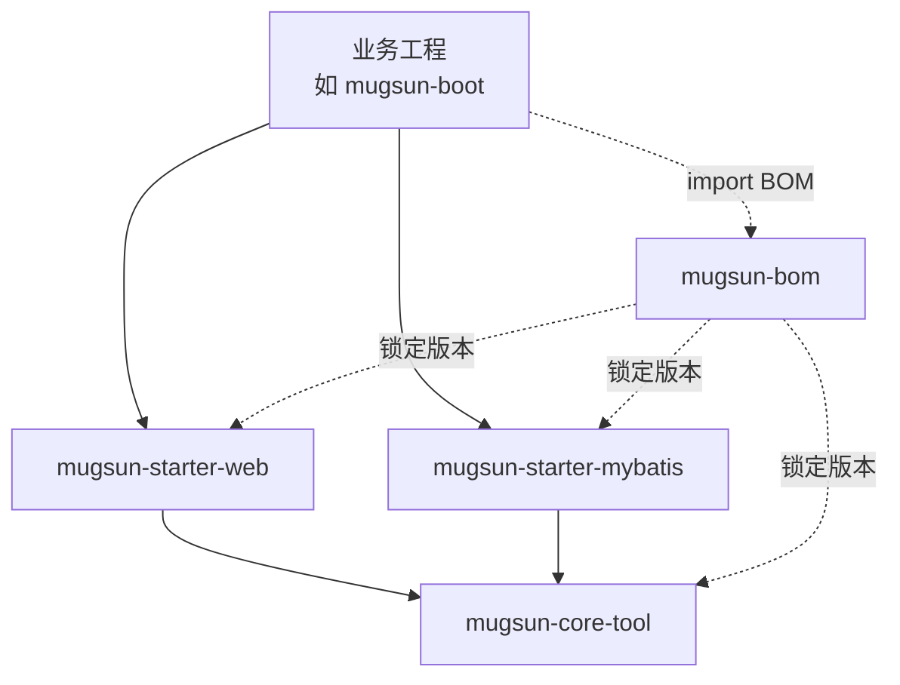
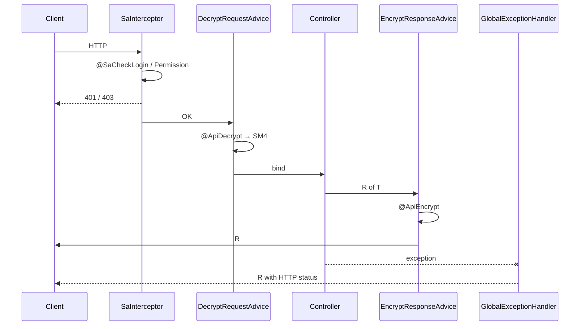

# mugsun-core

**中文** | [English](README_EN.md)


mugsun 平台的**公共内核**：一份依赖 BOM + 两个可复用 Starter。业务工程引入后即可获得统一响应、全局异常、Sa-Token 注解鉴权、接口国密加解密，以及 MyBatis-Flex 实体基类——不必在每个服务里重写一遍。

- **适合**：搭建与 [mugsun-boot](https://github.com/mugsun/mugsun-boot) 同栈的 Spring Boot 3.5 服务，或扩展 mugsun 模块。
- **不是**：可独立运行的业务后端；本仓不提供 HTTP 入口，消费者是 boot 等业务工程。

文档：[docs.mugsun.com](https://docs.mugsun.com/) · [Core 章节](https://docs.mugsun.com/core/) · [架构](https://docs.mugsun.com/guide/architecture)

当前版本 **0.1.0**（与 boot 对齐）。尚未发布到 Maven Central，需本地 `mvn install`。

## 模块

| 模块 | 职责 | 关键类型 |
| --- | --- | --- |
| `mugsun-bom` | 全栈依赖版本锁定（含对 Flex 传递旧版 `mybatis-spring` 的显式覆盖 → **3.0.5**） | —（pom） |
| `mugsun-core-tool` | 统一响应、状态码、业务异常、树工具 | `R`、`ResultCode`、`ServiceException`、`ForbiddenException`、`TreeUtil` |
| `mugsun-starter-web` | Web 基座：全局异常、注解鉴权、接口加解密、Long 精度安全、Excel | `MugsunWebAutoConfiguration`、`GlobalExceptionHandler`、`ApiCryptoService`、`SafeNumberModule`、`ExcelUtil` |
| `mugsun-starter-mybatis` | 持久层：MyBatis-Flex 装配 + 实体基类 | `BaseEntity` |



BOM 还统一锁定业务侧常用依赖版本（供 boot 等 import），例如：JetCache、x-file-storage、SMS4J、Warm-Flow、PowerJob、LiteFlow、FastExcel、Hutool、BouncyCastle、JustAuth、ip2region、springdoc 等——**版本以本仓根 `pom.xml` / `mugsun-bom` 为准**。

## 快速接入

### 1. 安装到本地仓库

```bash
git clone https://github.com/mugsun/mugsun-core.git
cd mugsun-core
mvn clean install
```

与 boot 联调时保持平级目录：`mugsun/mugsun-core` 与 `mugsun/mugsun-boot`。

### 2. 业务工程导入 BOM

版本须与本仓一致（当前 `0.1.0`）：

```xml
<dependencyManagement>
  <dependencies>
    <dependency>
      <groupId>com.mugsun</groupId>
      <artifactId>mugsun-bom</artifactId>
      <version>0.1.0</version>
      <type>pom</type>
      <scope>import</scope>
    </dependency>
  </dependencies>
</dependencyManagement>
```

### 3. 按需引入 Starter

版本由 BOM 管理，不必再写 `<version>`：

```xml
<dependencies>
  <dependency>
    <groupId>com.mugsun</groupId>
    <artifactId>mugsun-starter-web</artifactId>
  </dependency>
  <dependency>
    <groupId>com.mugsun</groupId>
    <artifactId>mugsun-starter-mybatis</artifactId>
  </dependency>
</dependencies>
```

## Starter 提供的能力

均来自当前源码，引入对应 jar 后由 `AutoConfiguration.imports` 显式装配：

- **统一响应 `R<T>` / `ResultCode`**：`code` · `success` · `data` · `msg`；加密响应用 `dataType=ENCRYPT`。
- **全局异常**：`ServiceException` 按业务码返回；未登录 401、越权 403、参数 400、404、405；兜底 500 可发布 `ErrorLogListener` 事件落库。
- **注解鉴权**：注册 `SaInterceptor` 拦截 `/**`，直接使用 `@SaCheckLogin` / `@SaCheckPermission` 等。
- **接口国密加解密**：`@ApiDecrypt` / `@ApiEncrypt`，SM4-CBC + 每请求随机 IV；密钥经业务侧 `mugsun.crypto.api-key` 注入。
- **Long 精度安全**：`SafeNumberModule` 将超出 JS 安全整数的 `Long`/`BigInteger` 序列化为字符串。
- **Excel**：`ExcelUtil`（FastExcel）读写，字段用 `@ExcelProperty`。
- **实体基类 `BaseEntity`**：雪花主键（flexId）、`create_time` / `update_time`（库端 `now()`）、逻辑删除；`sanitizeForInsert/Update` 剥离请求体伪造的审计字段。
- **树工具**：`TreeUtil.build()` 带环保护，脏父指针成环时剔除，避免 `StackOverflow`。

请求链路示意：



## 设计约定

- **Java 21**：根 POM `<java.version>21</java.version>`。
- **父工程**：`spring-boot-starter-parent` **3.5.13**。
- **显式自动装配**：`META-INF/spring/org.springframework.boot.autoconfigure.AutoConfiguration.imports`，不做组件扫描兜底。
- **可覆盖**：装配 Bean 带 `@ConditionalOnMissingBean`。
- **兼容修复**：MyBatis-Flex 传递的旧 `mybatis-spring` 与 Spring 6.2 冲突（`NoSuchMethodError`），BOM / starter 已锁定 **3.0.5**。

## 与 mugsun-boot

本仓是内核，不直接 `spring-boot:run`。[mugsun-boot](https://github.com/mugsun/mugsun-boot) 是首要消费者：import `mugsun-bom`，再依赖两个 starter，组装为单体后端。CI 与 Dockerfile 均要求两仓平级。

免费开源主线：`boot` · `core` · `pc` · `track`。cloud / uniappx-ui 规划或商业意向，不以本仓名义写成已交付产品。

## 构建与 CI

```bash
mvn -B install
```

GitHub Actions：JDK 21 Temurin，`mvn -B install`（见 `.github/workflows/ci.yml`）。

提交规范：[.github/COMMIT_CONVENTION.md](.github/COMMIT_CONVENTION.md)。

## 相关链接

| 资源 | 地址 |
| --- | --- |
| 文档站 | https://docs.mugsun.com/ |
| Core 文档 | https://docs.mugsun.com/core/ |
| Boot | https://github.com/mugsun/mugsun-boot |
| 管理端 | https://github.com/mugsun/mugsun-pc |
| 官网 | https://mugsun.com |

## 许可证

[Apache License 2.0](LICENSE)
