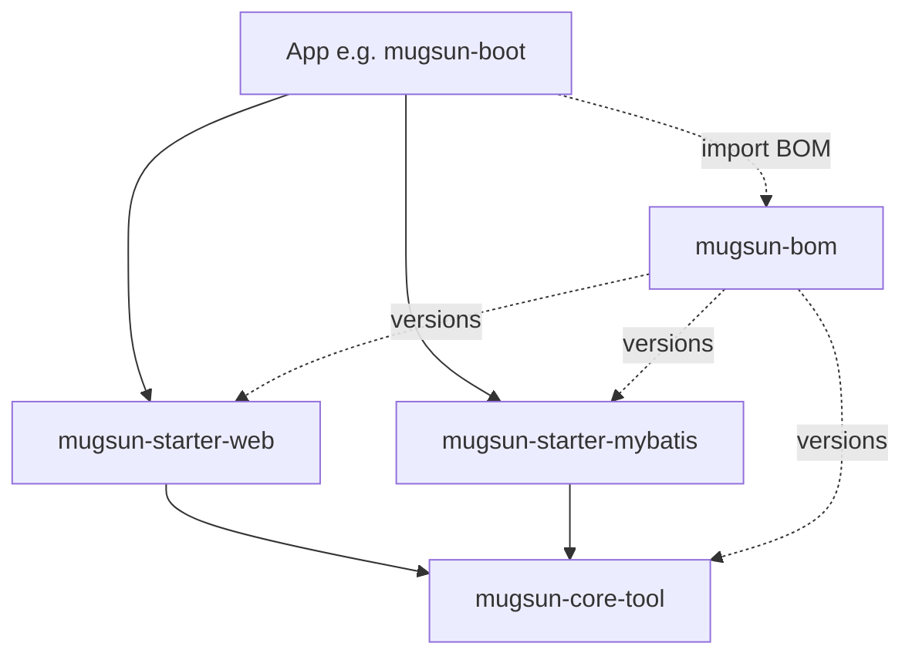
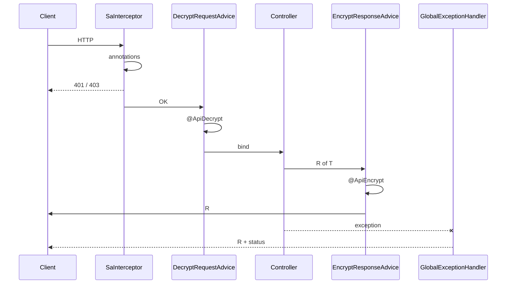

# mugsun-core

[中文](README.md) | **English**


The **shared kernel** of the mugsun platform: a dependency BOM plus two reusable starters. Import them into a Spring Boot app to get a unified API envelope, global exception handling, Sa-Token annotation auth, SM4 request/response crypto, and a MyBatis-Flex `BaseEntity` — without reimplementing the same plumbing in every service.

- **For** services on the same stack as [mugsun-boot](https://github.com/mugsun/mugsun-boot), or new mugsun modules.
- **Not** a runnable business backend; there is no HTTP entrypoint here.

Docs: [docs.mugsun.com](https://docs.mugsun.com/) · [Core](https://docs.mugsun.com/core/) · [Architecture](https://docs.mugsun.com/guide/architecture)

Current version **0.1.0** (aligned with boot). Not published to Maven Central yet — install locally.

## Modules

| Module | Role | Key types |
| --- | --- | --- |
| `mugsun-bom` | Locks dependency versions (incl. overriding Flex’s old `mybatis-spring` → **3.0.5**) | — (pom) |
| `mugsun-core-tool` | Response envelope, codes, exceptions, tree util | `R`, `ResultCode`, `ServiceException`, `ForbiddenException`, `TreeUtil` |
| `mugsun-starter-web` | Web base: exceptions, auth interceptor, API crypto, safe Long JSON, Excel | `MugsunWebAutoConfiguration`, `GlobalExceptionHandler`, `ApiCryptoService`, `SafeNumberModule`, `ExcelUtil` |
| `mugsun-starter-mybatis` | Persistence: MyBatis-Flex + entity base | `BaseEntity` |



The BOM also pins versions used by boot (JetCache, x-file-storage, SMS4J, Warm-Flow, PowerJob, LiteFlow, FastExcel, Hutool, BouncyCastle, JustAuth, ip2region, springdoc, …). **Treat root `pom.xml` / `mugsun-bom` as source of truth.**

## Quick start

### 1. Install locally

```bash
git clone https://github.com/mugsun/mugsun-core.git
cd mugsun-core
mvn clean install
```

For boot, keep a sibling layout: `mugsun/mugsun-core` next to `mugsun/mugsun-boot`.

### 2. Import the BOM

Match this repo’s version (currently `0.1.0`):

```xml
<dependencyManagement>
  <dependencies>
    <dependency>
      <groupId>com.mugsun</groupId>
      <artifactId>mugsun-bom</artifactId>
      <version>0.1.0</version>
      <type>pom</type>
      <scope>import</scope>
    </dependency>
  </dependencies>
</dependencyManagement>
```

### 3. Add starters

Versions come from the BOM:

```xml
<dependencies>
  <dependency>
    <groupId>com.mugsun</groupId>
    <artifactId>mugsun-starter-web</artifactId>
  </dependency>
  <dependency>
    <groupId>com.mugsun</groupId>
    <artifactId>mugsun-starter-mybatis</artifactId>
  </dependency>
</dependencies>
```

## What the starters provide

Wired via `AutoConfiguration.imports` when the jar is on the classpath:

- **`R<T>` / `ResultCode`**: `code`, `success`, `data`, `msg`; encrypted payloads use `dataType=ENCRYPT`.
- **Global exceptions**: business via `ServiceException`; 401 / 403 / 400 / 404 / 405; 500 can emit `ErrorLogListener`.
- **Annotation auth**: `SaInterceptor` on `/**` for `@SaCheckLogin`, `@SaCheckPermission`, etc.
- **API crypto**: `@ApiDecrypt` / `@ApiEncrypt`, SM4-CBC with per-request IV; key from app config `mugsun.crypto.api-key`.
- **Safe Long JSON**: values outside JS safe-integer range serialize as strings.
- **Excel**: `ExcelUtil` (FastExcel) with `@ExcelProperty`.
- **`BaseEntity`**: flexId snowflake, DB `now()` timestamps, logic delete; `sanitizeForInsert/Update` strips forged audit fields.
- **`TreeUtil.build()`**: cycle-safe tree build.



## Conventions

- **Java 21**
- Parent: `spring-boot-starter-parent` **3.5.13**
- Explicit auto-config only (no component-scan fallback)
- Beans are `@ConditionalOnMissingBean`
- Flex’s transitive old `mybatis-spring` is overridden to **3.0.5** for Spring 6.2

## Relationship to mugsun-boot

This repo does not run by itself. [mugsun-boot](https://github.com/mugsun/mugsun-boot) imports the BOM and both starters. CI and the boot Dockerfile expect the two repos as siblings.

Free OSS line: `boot` · `core` · `pc` · `track`. cloud / uniappx-ui are planned or commercial — not claimed as shipped open products here.

## Build & CI

```bash
mvn -B install
```

GitHub Actions: Temurin JDK 21, `mvn -B install`. Commit style: [.github/COMMIT_CONVENTION.md](.github/COMMIT_CONVENTION.md).

## Links

| | |
| --- | --- |
| Docs | https://docs.mugsun.com/ |
| Core docs | https://docs.mugsun.com/core/ |
| Boot | https://github.com/mugsun/mugsun-boot |
| Admin UI | https://github.com/mugsun/mugsun-pc |
| Site | https://mugsun.com |

## License

[Apache License 2.0](LICENSE)
