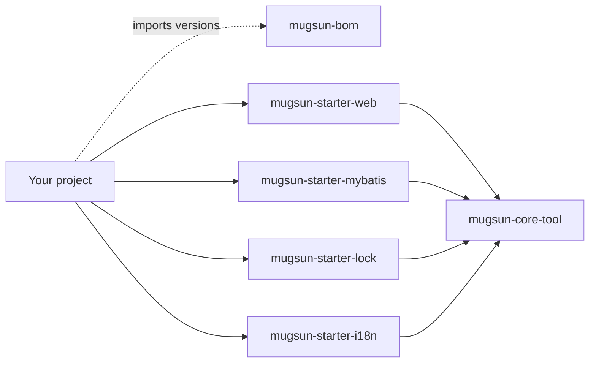

# mugsun-core

[中文](./README.md) | [Docs](https://docs.mugsun.com/en/core/) | [Changelog](./CHANGELOG.md)

[](https://github.com/mugsun/mugsun-core/actions/workflows/ci.yml)
[](https://central.sonatype.com/search?q=com.mugsun)
[](./LICENSE)

The shared library behind the mugsun backend: a BOM, a small utility module and four Spring Boot starters.

Add it and your endpoints get one response format, global exception handling and Sa-Token annotation checks. It is a library and does not run on its own. The runnable backend is [mugsun-boot](https://github.com/mugsun/mugsun-boot).

## Install

The main branch is at `0.3.0-SNAPSHOT` (built on Spring Boot 4), which is not on Maven Central yet, so install it into your local repository first. You need JDK 21 and Maven 3.9+.

```bash
git clone https://github.com/mugsun/mugsun-core.git && cd mugsun-core
mvn -B clean install -DskipTests
```

Then import the BOM in your own project and declare the starters you use:

```xml
<dependencyManagement>
  <dependencies>
    <dependency>
      <groupId>com.mugsun</groupId>
      <artifactId>mugsun-bom</artifactId>
      <version>0.3.0-SNAPSHOT</version>
      <type>pom</type>
      <scope>import</scope>
    </dependency>
  </dependencies>
</dependencyManagement>

<dependencies>
  <dependency>
    <groupId>com.mugsun</groupId>
    <artifactId>mugsun-starter-web</artifactId>
  </dependency>
  <dependency>
    <groupId>com.mugsun</groupId>
    <artifactId>mugsun-starter-mybatis</artifactId>
  </dependency>
</dependencies>
```

Maven Central only has the old `0.1.0`. Don't combine it with mugsun-boot from the main branch.

Its API encryption is not compatible with the main branch, and it was published under Apache-2.0.

The differences between the two versions are listed in the [upgrade notes](https://docs.mugsun.com/en/guide/upgrade/core-0-2-0).

## Write an endpoint

```java
@RestController
@RequestMapping("/book")
public class BookController {

    private final BookService bookService;

    public BookController(BookService bookService) {
        this.bookService = bookService;
    }

    @SaCheckPermission("book:view")
    @GetMapping("/{id}")
    public R<BookVO> detail(@PathVariable Long id) {
        BookVO book = bookService.detail(id);
        if (book == null) {
            throw new ServiceException("Book not found");
        }
        return R.data(book);
    }
}
```

When the book exists, the response looks like this:

```json
{
  "code": 200,
  "success": true,
  "data": { "id": "277980892367867904", "title": "The Three-Body Problem" },
  "msg": "操作成功",
  "dataType": null
}
```

`id` is a string. Any `Long` or `BigInteger` outside ±2^53 is serialised as a string, so long primary keys keep their precision in the browser. The built-in messages are in Chinese. With `mugsun-starter-i18n` they follow the language of the request, see [Messages in other languages](#messages-in-other-languages).

You don't handle the other cases yourself. The starters turn them into the same format:

| Case | HTTP status | `code` |
| --- | --- | --- |
| `ServiceException` thrown | 200 | 400, or any `ResultCode` you pass |
| Validation failed | 400 | 400 |
| Not signed in | 401 | 401 |
| Missing permission or role, or `ForbiddenException` thrown | 403 | 403 |
| Unknown URL | 404 | 404 |
| Wrong HTTP method | 405 | 400 |
| Unique constraint violated (needs `mugsun-starter-mybatis`) | 400 | 400 |
| Any other uncaught exception | 500 | 500 |

Uncaught exceptions are also passed to `ErrorLogListener`. Implement that interface as a bean to write errors to your own log table.

## Modules



| Module | Contents |
| --- | --- |
| `mugsun-bom` | Pins the versions of this repository's artifacts and of third-party dependencies such as MyBatis-Flex, Sa-Token and JetCache |
| `mugsun-core-tool` | The response wrapper `R`, business exceptions and a tree helper. No Spring dependency |
| `mugsun-starter-web` | Global exception handling, annotation checks and API encryption, plus safe serialisation of big integers and an Excel helper |
| `mugsun-starter-mybatis` | MyBatis-Flex, the entity base class `BaseEntity`, and the handler for unique constraint violations |
| `mugsun-starter-lock` | A distributed lock, used through an annotation or a template. It uses Redis when the project has it and falls back to an in-process lock when it does not |
| `mugsun-starter-i18n` | Messages in the language of the request. The messages already written in the code stay as they are, and you add a translation file |

Every bean the starters register can be replaced. Declare a bean of the same type and the starter's one backs off.

### Entity base class

```java
@Table("book")
public class Book extends BaseEntity {
    private String title;
}
```

An entity that extends `BaseEntity` gets a generated `long` primary key, `id`. The base class also maintains the creation time, the update time and the logical-delete flag.

Call `sanitizeForInsert()` before saving to drop any times or delete flag that came in with the request body.

### Trees and Excel

```java
// The node class implements INode<T>; the second argument is the parentId of root nodes
List<Menu> tree = TreeUtil.build(menus, 0L);

// Columns are mapped to fields with @ExcelProperty
List<BookRow> rows = ExcelUtil.read(file, BookRow.class);
ExcelUtil.export(response, "books", "Sheet1", rows, BookRow.class);
```

## API encryption

`@ApiDecrypt` on an endpoint decrypts the request body, and `@ApiEncrypt` encrypts `data` in the response. The algorithm is SM4-GCM.

```java
@ApiDecrypt
@ApiEncrypt
@PostMapping("/login")
public R<LoginVO> login(@RequestBody LoginDTO dto) {
    return R.data(authService.login(dto));
}
```

The request body has to be `{"encryptData": "<ciphertext>"}`. In the response, `data` is ciphertext and `dataType` is `ENCRYPT`.

> [!WARNING]
> This is transport obfuscation and does not replace HTTPS. The key is sent to the browser, so it is not secret from the client, and ciphertext can be replayed.

The application starts without a key. On first start it generates a 16-byte key, stores it in `~/.mugsun/api-transport.key` and reuses it on later starts.

In two kinds of deployment you must set the key yourself or mount a shared volume for the key directory:

- Docker without a volume for that directory. Every restart would generate a new key.
- More than one instance. Each instance would generate its own key and could not decrypt the others' data.

| Property | Default | Notes |
| --- | --- | --- |
| `mugsun.crypto.api-key` | empty | 32 hex characters, or base64 that decodes to exactly 16 bytes. A malformed value stops the startup |
| `mugsun.home` | `~/.mugsun` | The directory for the generated key file |

You can generate a key with `openssl rand -hex 16`.

In mugsun-boot the two properties map to the environment variables `MUGSUN_API_KEY` and `MUGSUN_HOME`.

Ciphertext is `base64(12-byte IV + ciphertext + 16-byte tag)`.

If you write a client in another language, check it against the data in [api-crypto-vectors.json](./mugsun-starter-web/src/test/resources/crypto/api-crypto-vectors.json).

More details are in the [configuration reference](https://docs.mugsun.com/en/boot/configuration).

## Distributed lock

With `mugsun-starter-lock`, only one instance does a given piece of work at a time. It needs no configuration. If the project has Redis, the lock lives in Redis. If it does not, the starter falls back to an in-process lock and says so in the startup log.

```xml
<dependency>
  <groupId>com.mugsun</groupId>
  <artifactId>mugsun-starter-lock</artifactId>
</dependency>
```

Put the annotation on a method:

```java
// One payment per order at a time. Other requests wait up to 3 seconds,
// then get the business failure "操作正在进行中，请稍后再试".
@DistributedLock(key = "#orderId", waitTime = 3)
public void pay(Long orderId) {
    // ...
}

// A scheduled job: one instance runs it, the others skip this round.
@Scheduled(cron = "0 0 3 * * *")
@DistributedLock(name = "job:log-clean", onFail = LockFailAction.SKIP)
public void clean() {
    // ...
}
```

Or inject `LockTemplate` and call it yourself:

```java
// Waits up to 3 seconds, then throws LockFailedException
lockTemplate.run("order:pay:" + orderId, Duration.ofSeconds(3), () -> pay(orderId));

// Skips when the lock is taken. The return value tells you whether it ran
boolean ran = lockTemplate.tryRun("job:log-clean", this::clean);
```

The conventions:

- Without a lease time, the lock is held until the method returns and is renewed while the method runs. If the process dies, nobody renews it and the lock frees itself within 30 seconds.
- With `leaseTime`, the lease is fixed. The lock is freed when the time is up, whether or not the method has finished.
- The lock wraps the transaction. It is taken before the transaction starts and freed after the transaction commits.
- A thread can take a lock it already holds.
- When the lock cannot be taken, `LockFailedException` is thrown. It is a `ServiceException`, so the endpoint returns an ordinary business failure.
- The annotation works through the Spring proxy, so a call from within the same class is not locked. Use `LockTemplate` there.

| Property | Default | Notes |
| --- | --- | --- |
| `mugsun.lock.type` | `auto` | `auto`: Redis when the project has it, otherwise the in-process lock. `redis`: Redis is required, and the application refuses to start when the project has no Redis configured. `local`: the in-process lock only |
| `mugsun.lock.key-prefix` | `lock:` | The prefix of every lock key in Redis |
| `mugsun.lock.lease-time` | `30s` | The lease used when none is given. It is renewed while the lock is held |
| `mugsun.lock.retry-interval` | `100ms` | How often a waiting caller tries again |
| `mugsun.lock.enabled` | `true` | Set it to `false` to turn the starter off |

> [!WARNING]
> The in-process lock only works within one instance. If you run more than one instance, add `spring-boot-starter-data-redis`. In production, set `mugsun.lock.type=redis`, so that a project without Redis fails at startup instead of quietly falling back to the in-process lock.

The lock prevents concurrent execution under normal conditions. If Redis loses its data or the process pauses for a long time, a second caller can still get in. Where that is not acceptable, back the lock with a unique constraint or a version column in the database.

## Messages in other languages

With `mugsun-starter-i18n`, the messages your endpoints return follow the `Accept-Language` request header. It needs no configuration, and the messages already written in your code stay as they are. You add a translation file.

```xml
<dependency>
  <groupId>com.mugsun</groupId>
  <artifactId>mugsun-starter-i18n</artifactId>
</dependency>
```

Create `src/main/resources/i18n/messages_en.properties`. The text from the code goes on the left of the equals sign and the translation on the right:

```properties
用户不存在=User not found
用户 {0} 不存在=User {0} does not exist
名称不能为空=Name is required
```

Write the code as usual:

```java
// A fixed sentence needs no change. A request in English gets "User not found",
// and a request in Chinese gets the original text.
throw new ServiceException("用户不存在");

// A sentence with variables goes through I18n.get. Mark the variables with {0}, {1}
throw new ServiceException(I18n.get("用户 {0} 不存在", username));

// Messages on validation annotations work the same way
@NotBlank(message = "名称不能为空")
private String name;
```

The library's own messages, such as "操作成功", "没有访问权限" and "资源不存在", come with English translations.

The conventions:

- Translation files live in the `i18n/` directory and are named `name_language.properties`, for example `messages_en`, `messages_zh_TW` and `messages_ja`. They are UTF-8, so write non-ASCII text as it is.
- On each line, everything left of the first equals sign is the key. Spaces and colons need no escaping. Write an equals sign inside a key as `\=`.
- `messages.properties`, without a language, holds the fallback text. It is used when a language has no entry for a sentence.
- When a request has no `Accept-Language`, or asks only for languages that are not supported, the default language (Simplified Chinese) is used. You don't register the supported languages. They are the default language, Simplified Chinese, and every language that has a translation file.
- A missing translation is not an error. The text is returned as it is.
- When several files translate the same sentence, the application's own `messages` files win. To replace one of the library's translations, put the same key in your `messages_en.properties`.
- Only `msg` in the response wrapper `R` is translated. `data` is left alone.
- If you prefer codes to sentences as keys, use `ServiceException("{order.closed}")`, `@NotBlank(message = "{user.name.required}")` or `I18n.get("order.created", orderNo)`. The Chinese text then goes into `i18n/messages.properties`.
- In a translation that contains `{0}`, write a single quote twice (`It''s {0}`). Numbers get the grouping separators of the language, so pass order numbers and the like as strings.
- The language belongs to the thread that handles the request. Code in `@Async` methods, thread pools and scheduled jobs gets the default language. Use `I18n.get(locale, ...)` when it needs another one.
- A filter that writes its own response, such as a rate limiter or a login check, does not go through the response wrapper `R`, so it translates the message itself: `I18n.translate("请求过于频繁")`. A filter gets the same language as a controller.
- `messages*.properties` in the classpath root, the Spring Boot convention, is read as well.

If your texts live in a database, implement `MessageProvider` and register it as a bean. It is asked first, and the translation files are used when it returns `null`:

```java
@Component
public class DbMessageProvider implements MessageProvider {

    @Override
    public String find(String code, Locale locale) {
        // Called on every lookup, so read from a cache, not from the database
        return cache.get(locale, code);
    }
}
```

An error in a `MessageProvider` does not fail the request. That lookup uses the translation files instead, and a WARN is logged, at most once a minute.

| Property | Default | Notes |
| --- | --- | --- |
| `mugsun.i18n.default-locale` | `zh-CN` | Used when a request names no language, or only unsupported ones. Code that runs outside a request, such as a scheduled job, uses it too |
| `mugsun.i18n.supported-locales` | empty | When empty, the list is worked out for you: the default language, Simplified Chinese, and every language that has a translation file. When set, only the default language and the listed ones count |
| `mugsun.i18n.translate-response` | `true` | Translates the message in `R` before the response is written. With `false`, only texts fetched through `I18n.get` follow the language |
| `mugsun.i18n.enabled` | `true` | Set it to `false` to turn the starter off |

> [!NOTE]
> The frontend has to send `Accept-Language`. mugsun-pc already does, and the header follows the language chosen in the console.

Simplified Chinese always counts as supported because the messages in the code are written in it. For a project that should answer in English only, set both `mugsun.i18n.default-locale` and `mugsun.i18n.supported-locales` to `en`.

To decide the language another way, for example from the signed-in user's settings, register your own bean named `localeResolver` and the starter's one backs off.

An application that is not Spring MVC, such as Spring Cloud Gateway, can use the starter too. The translation files are read as usual, but the language is not decided for you and responses are not translated automatically. Decide the language from the request header first, then translate:

```java
Locale locale = I18n.negotiate(request.getHeaders().getFirst("Accept-Language"));
String msg = I18n.translate(locale, "请求未授权");
```

## Current limits

- `0.3.0-SNAPSHOT` is not on Maven Central. You have to install it locally.
- It needs Spring Boot 4 and JDK 21. Projects still on Spring Boot 3 should use `0.2.x` (branch `release/0.2.0`).
- JSON still goes through Jackson 2 for now. Spring Boot 4 defaults to Jackson 3, so `mugsun-starter-web` sets the default JSON library for reading and writing request and response bodies back to Jackson 2, and custom serializers are still written against `com.fasterxml.jackson`. Setting `spring.http.converters.preferred-json-mapper` to `jackson` in your application switches back to Jackson 3, but features written against Jackson 2, such as writing large `Long` values as strings, will not apply.
- It supports Spring MVC only, not WebFlux.
- A caller waiting for the distributed lock retries on a timer, so the lock is not first come, first served.
- Translation matches whole sentences. A sentence built by string concatenation does not match, so write it with `I18n.get` to have it translated.

## Related repositories

| Repository | What it is |
| --- | --- |
| [mugsun-boot](https://github.com/mugsun/mugsun-boot) | The backend, and the main user of this library |
| [mugsun-pc](https://github.com/mugsun/mugsun-pc) | The admin console |
| [mugsun-docs](https://github.com/mugsun/mugsun-docs) | Source of the documentation site, [docs.mugsun.com](https://docs.mugsun.com/en/) |

## Contributing

Read the [contributing guide](https://github.com/mugsun/.github/blob/main/CONTRIBUTING_EN.md) before you send a change. Report security issues privately as described in [SECURITY.md](https://github.com/mugsun/.github/blob/main/SECURITY.md). Please do not open a public issue.

<details>
<summary>Publishing to Maven Central</summary>

Publish a GitHub Release in this repository, or run the `Publish to Maven Central` workflow by hand.

The local equivalent is below. It needs a Central Portal token and GPG set up first:

```bash
mvn -Prelease clean deploy -DskipTests
```

</details>

## License

MIT, see [LICENSE](./LICENSE). The `0.1.0` artifacts on Maven Central were published under Apache-2.0.
