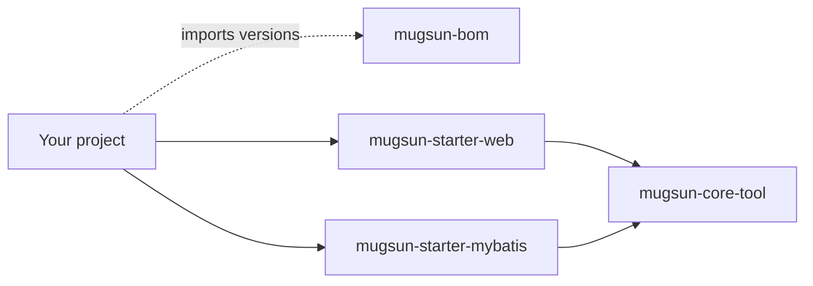

# mugsun-core

[中文](./README.md) | [Docs](https://docs.mugsun.com/en/core/) | [Changelog](./CHANGELOG.md)

[](https://github.com/mugsun/mugsun-core/actions/workflows/ci.yml)
[](https://central.sonatype.com/search?q=com.mugsun)
[](./LICENSE)

The shared library behind the mugsun backend: a BOM, a small utility module and two Spring Boot starters.

Add it and your endpoints get one response format, global exception handling and Sa-Token annotation checks. It is a library and does not run on its own. The runnable backend is [mugsun-boot](https://github.com/mugsun/mugsun-boot).

## Install

The main branch is at `0.2.0-SNAPSHOT`, which is not on Maven Central yet, so install it into your local repository first. You need JDK 21 and Maven 3.9+.

```bash
git clone https://github.com/mugsun/mugsun-core.git && cd mugsun-core
mvn -B clean install -DskipTests
```

Then import the BOM in your own project and declare the starters you use:

```xml
<dependencyManagement>
  <dependencies>
    <dependency>
      <groupId>com.mugsun</groupId>
      <artifactId>mugsun-bom</artifactId>
      <version>0.2.0-SNAPSHOT</version>
      <type>pom</type>
      <scope>import</scope>
    </dependency>
  </dependencies>
</dependencyManagement>

<dependencies>
  <dependency>
    <groupId>com.mugsun</groupId>
    <artifactId>mugsun-starter-web</artifactId>
  </dependency>
  <dependency>
    <groupId>com.mugsun</groupId>
    <artifactId>mugsun-starter-mybatis</artifactId>
  </dependency>
</dependencies>
```

Maven Central only has the old `0.1.0`. Don't combine it with mugsun-boot from the main branch.

Its API encryption is not compatible with the main branch, and it was published under Apache-2.0.

The differences between the two versions are listed in the [upgrade notes](https://docs.mugsun.com/en/guide/upgrade/core-0-2-0).

## Write an endpoint

```java
@RestController
@RequestMapping("/book")
public class BookController {

    private final BookService bookService;

    public BookController(BookService bookService) {
        this.bookService = bookService;
    }

    @SaCheckPermission("book:view")
    @GetMapping("/{id}")
    public R<BookVO> detail(@PathVariable Long id) {
        BookVO book = bookService.detail(id);
        if (book == null) {
            throw new ServiceException("Book not found");
        }
        return R.data(book);
    }
}
```

When the book exists, the response looks like this:

```json
{
  "code": 200,
  "success": true,
  "data": { "id": "277980892367867904", "title": "The Three-Body Problem" },
  "msg": "操作成功",
  "dataType": null
}
```

`id` is a string. Any `Long` or `BigInteger` outside ±2^53 is serialised as a string, so long primary keys keep their precision in the browser. The built-in messages are in Chinese.

You don't handle the other cases yourself. The starters turn them into the same format:

| Case | HTTP status | `code` |
| --- | --- | --- |
| `ServiceException` thrown | 200 | 400, or any `ResultCode` you pass |
| Validation failed | 400 | 400 |
| Not signed in | 401 | 401 |
| Missing permission or role, or `ForbiddenException` thrown | 403 | 403 |
| Unknown URL | 404 | 404 |
| Wrong HTTP method | 405 | 400 |
| Unique constraint violated (needs `mugsun-starter-mybatis`) | 400 | 400 |
| Any other uncaught exception | 500 | 500 |

Uncaught exceptions are also passed to `ErrorLogListener`. Implement that interface as a bean to write errors to your own log table.

## Modules



| Module | Contents |
| --- | --- |
| `mugsun-bom` | Pins the versions of this repository's artifacts and of third-party dependencies such as MyBatis-Flex, Sa-Token and JetCache |
| `mugsun-core-tool` | The response wrapper `R`, business exceptions and a tree helper. No Spring dependency |
| `mugsun-starter-web` | Global exception handling, annotation checks and API encryption, plus safe serialisation of big integers and an Excel helper |
| `mugsun-starter-mybatis` | MyBatis-Flex, the entity base class `BaseEntity`, and the handler for unique constraint violations |

Every bean the starters register can be replaced. Declare a bean of the same type and the starter's one backs off.

### Entity base class

```java
@Table("book")
public class Book extends BaseEntity {
    private String title;
}
```

An entity that extends `BaseEntity` gets a generated `long` primary key, `id`. The base class also maintains the creation time, the update time and the logical-delete flag.

Call `sanitizeForInsert()` before saving to drop any times or delete flag that came in with the request body.

### Trees and Excel

```java
// The node class implements INode<T>; the second argument is the parentId of root nodes
List<Menu> tree = TreeUtil.build(menus, 0L);

// Columns are mapped to fields with @ExcelProperty
List<BookRow> rows = ExcelUtil.read(file, BookRow.class);
ExcelUtil.export(response, "books", "Sheet1", rows, BookRow.class);
```

## API encryption

`@ApiDecrypt` on an endpoint decrypts the request body, and `@ApiEncrypt` encrypts `data` in the response. The algorithm is SM4-GCM.

```java
@ApiDecrypt
@ApiEncrypt
@PostMapping("/login")
public R<LoginVO> login(@RequestBody LoginDTO dto) {
    return R.data(authService.login(dto));
}
```

The request body has to be `{"encryptData": "<ciphertext>"}`. In the response, `data` is ciphertext and `dataType` is `ENCRYPT`.

> [!WARNING]
> This is transport obfuscation and does not replace HTTPS. The key is sent to the browser, so it is not secret from the client, and ciphertext can be replayed.

The application starts without a key. On first start it generates a 16-byte key, stores it in `~/.mugsun/api-transport.key` and reuses it on later starts.

In two kinds of deployment you must set the key yourself or mount a shared volume for the key directory:

- Docker without a volume for that directory. Every restart would generate a new key.
- More than one instance. Each instance would generate its own key and could not decrypt the others' data.

| Property | Default | Notes |
| --- | --- | --- |
| `mugsun.crypto.api-key` | empty | 32 hex characters, or base64 that decodes to exactly 16 bytes. A malformed value stops the startup |
| `mugsun.home` | `~/.mugsun` | The directory for the generated key file |

You can generate a key with `openssl rand -hex 16`.

In mugsun-boot the two properties map to the environment variables `MUGSUN_API_KEY` and `MUGSUN_HOME`.

Ciphertext is `base64(12-byte IV + ciphertext + 16-byte tag)`.

If you write a client in another language, check it against the data in [api-crypto-vectors.json](./mugsun-starter-web/src/test/resources/crypto/api-crypto-vectors.json).

More details are in the [configuration reference](https://docs.mugsun.com/en/boot/configuration).

## Current limits

- `0.2.0-SNAPSHOT` is not on Maven Central. You have to install it locally.
- It needs Spring Boot 3 and JDK 21. Earlier versions are not supported.
- It supports Spring MVC only, not WebFlux.

## Related repositories

| Repository | What it is |
| --- | --- |
| [mugsun-boot](https://github.com/mugsun/mugsun-boot) | The backend, and the main user of this library |
| [mugsun-pc](https://github.com/mugsun/mugsun-pc) | The admin console |
| [mugsun-docs](https://github.com/mugsun/mugsun-docs) | Source of the documentation site, [docs.mugsun.com](https://docs.mugsun.com/en/) |

## Contributing

Read the [contributing guide](https://github.com/mugsun/.github/blob/main/CONTRIBUTING_EN.md) before you send a change. Report security issues privately as described in [SECURITY.md](https://github.com/mugsun/.github/blob/main/SECURITY.md). Please do not open a public issue.

<details>
<summary>Publishing to Maven Central</summary>

Publish a GitHub Release in this repository, or run the `Publish to Maven Central` workflow by hand.

The local equivalent is below. It needs a Central Portal token and GPG set up first:

```bash
mvn -Prelease clean deploy -DskipTests
```

</details>

## License

MIT, see [LICENSE](./LICENSE). The `0.1.0` artifacts on Maven Central were published under Apache-2.0.
