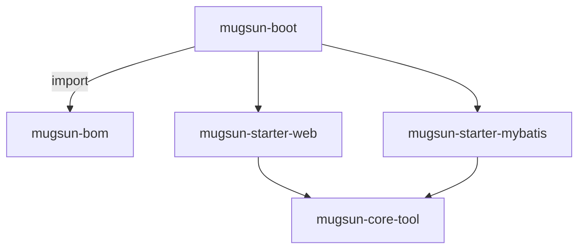

<p align="center">
  
</p>

# mugsun-core

[简体中文](./README.md) | English

**Shared kernel for the boot stack: one BOM, two starters, import from business apps.**  
Unified responses, Sa-Token annotation auth, API crypto, MyBatis-Flex base entities — not a runnable backend by itself.

[Docs](https://docs.mugsun.com/en/core/) · [Architecture](https://docs.mugsun.com/en/guide/architecture) · [Demo (coming soon)](https://docs.mugsun.com/en/demo)


---

## Why this

1. **Same version lock as boot** — Spring Boot **3.5.13**, Java **21**; `mugsun-bom` pins Flex / Sa-Token / JetCache and friends so every service does not invent its own BOM.
2. **Explicit auto-config** — `AutoConfiguration.imports` wires exception handling, auth interceptor, crypto, and entity base; beans are `@ConditionalOnMissingBean`.
3. **Install, then consume** — not on Maven Central yet; `mvn install` once, then [mugsun-boot](https://github.com/mugsun/mugsun-boot) (and siblings) import as peers.

No HTTP entrypoint and no `spring-boot:run` here — use boot for a runnable server.

---

## Shortest path

Clone as a sibling of boot:

```bash
git clone https://github.com/mugsun/mugsun-core.git
cd mugsun-core
mvn clean install -DskipTests
```

Business apps import the BOM (must match this repo — currently **0.1.0**), then the starters:

```xml
<dependencyManagement>
  <dependencies>
    <dependency>
      <groupId>com.mugsun</groupId>
      <artifactId>mugsun-bom</artifactId>
      <version>0.1.0</version>
      <type>pom</type>
      <scope>import</scope>
    </dependency>
  </dependencies>
</dependencyManagement>

<dependencies>
  <dependency>
    <groupId>com.mugsun</groupId>
    <artifactId>mugsun-starter-web</artifactId>
  </dependency>
  <dependency>
    <groupId>com.mugsun</groupId>
    <artifactId>mugsun-starter-mybatis</artifactId>
  </dependency>
</dependencies>
```

Full vertical slice: [boot shortest path](https://github.com/mugsun/mugsun-boot/blob/main/README_EN.md#shortest-local-path) · [docs](https://docs.mugsun.com/en/guide/getting-started).

---

## Shape



```text
mugsun-core/
  mugsun-bom/            # version lock (incl. mybatis-spring → 3.0.5 override)
  mugsun-core-tool/      # R / ResultCode / exceptions / TreeUtil
  mugsun-starter-web/    # exceptions, Sa interceptor, ApiCrypto, SafeNumber, Excel
  mugsun-starter-mybatis/ # Flex wiring + BaseEntity
```

> **Screenshot placeholder** — module / response samples go here when ready. See [Demo](https://docs.mugsun.com/en/demo).

Class lists and config keys live in [docs](https://docs.mugsun.com/en/core/) and source — not a capability matrix in this README.

---

## Honest boundaries

| Includes | Does not / not yet |
| --- | --- |
| BOM + web / mybatis starters | A standalone HTTP service |
| Local install aligned with boot **0.1.0** | Maven Central publish |
| Explicit fix for Flex’s old `mybatis-spring` | Claiming uniappx-ui / cloud as shipped |

Free OSS line: `boot` · `core` · `pc` · `track`. More: [docs.mugsun.com](https://docs.mugsun.com/en/).

---

## License

[Apache-2.0](./LICENSE)
